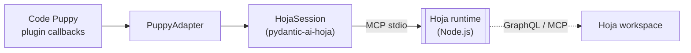

<div align="center">


# Hoja for Code Puppy

**Tasks that can't be marked done without proof.**
TaskManage, an evidence-checked task gate, Hoja issue sync and session traces, as a Code Puppy plugin.

[](LICENSE)
[](https://github.com/mpfaffenberger/code_puppy)
[](pyproject.toml)
[](https://github.com/hoja-work/hoja-pydantic-ai-plugin)
[](https://github.com/hoja-work/hoja-claude-plugin)

</div>

---

Agents say "done" too easily. With this plugin in Code Puppy:

- **Every task has acceptance questions.** "Do the tests pass?" "Is the README updated?", written up front.
- **Completion needs evidence that resolves.** Each answer cites `src/app.py#L10-L40`, `README.md#Install` or
  `tool:Bash#3`: a real file, or a real tool result from *this* session. Made-up evidence is rejected.
- **Nothing mutates without a task.** Until a task is focused, the gate refuses `shell` writes, `create_file`,
  `replace_in_file` and other acting tools, and the puppy reads why. Reads (`read_file`, `grep`, `list_files`, `ls`,
  `git log`) are always free.
- **Your tracker stays current by itself.** In Hoja mode each top-level task becomes a Hoja issue, its progress is
  rewritten in place, and an evidenced completion moves it to Done, with the session trace attached.

This is not a re-implementation. The gate, TaskManage and Hoja mode are the same runtime the
[Claude Code](https://github.com/hoja-work/hoja-claude-plugin), [Codex](https://github.com/hoja-work/hoja-codex-plugin)
and [Antigravity](https://github.com/hoja-work/hoja-antigravity-plugin) plugins run. It reaches Code Puppy through
[`pydantic-ai-hoja`](https://github.com/hoja-work/hoja-pydantic-ai-plugin), since Code Puppy is built on Pydantic AI.

## Contents

- [Install](#install)
- [Quick start](#quick-start)
- [What you get](#what-you-get)
- [Configuration](#configuration)
- [How it works](#how-it-works)
- [Troubleshooting](#troubleshooting)
- [Development](#development)

## Install

Code Puppy loads plugins installed in its own environment through the `code_puppy.plugins` entry point. Install the
plugin next to it:

```bash
# Code Puppy installed with uv
uv tool install code-puppy --with code-puppy-hoja

# Code Puppy installed with pipx
pipx inject code-puppy code-puppy-hoja
```

You also need **Node.js 22+** on `PATH` (or set `HOJA_NODE`); the shared runtime is TypeScript, bundled. Without it,
the plugin disables itself with one warning and Code Puppy runs as before.

To turn it off without uninstalling, add `hoja` to `disabled_plugins` in `puppy.cfg`.

## Quick start

1. **Sign in (optional).** Sign in once with the Hoja CLI; the runtime asks it for a fresh token and the workspace's
   endpoints:
   ```bash
   hoja auth login acme.hoja.work
   ```
   Or set credentials from inside Code Puppy: `/set hoja_api_url https://acme.hoja.work/graphql`, `/set hoja_token …`,
   `/set hoja_project "My Project"`. Without credentials, TaskManage and the gate still work and publication is
   skipped.
2. **Start Code Puppy** and check the setup:
   ```text
   /hoja setup
   ```
3. **Work as usual.** On its first unplanned write the puppy sees:
   ```text
   ERROR: 🚫 Hook blocked this tool call: Tool 'Bash' blocked by hook: [TASK ENFORCEMENT - BLOCKED] …
   ```
   It then creates a task with `TaskManage`, focuses it, does the work, and completes it with evidence the runtime
   checks. `/hoja` shows the board at any time.

## What you get

| | |
| --- | --- |
| **`TaskManage`** | Ordered, durable tasks with dependencies, sub-tasks, notes and 1–12 acceptance questions each, on every agent (including sub-agents). Completion is validated against the workspace and this session's tool results. |
| **Task gate** | Every tool call goes through `pre_tool_call`. `block` (default) refuses acting tools without a focused task; `advise` only nudges. |
| **Reminders** | Completion and task-maintenance nudges ride on the next model request, without rewriting history. |
| **Auto-continue** | When the puppy ends its turn right after a gate block, Code Puppy re-runs with the runtime's exact instructions, within the runtime's bounded budget. |
| **Hoja mode** | `hoja_list`, `hoja_get`, `hoja_project` and automatic publication: one issue per coarse task, acceptance questions in the description, an evidence comment and Done on completion. |
| **Hosted Hoja API** | The workspace's full MCP API (issues, comments, decisions, projects, cycles) as tools. Reads are exempt from the gate; writes are gated. |
| **Session traces** | Turns and every tool call with its outcome, as a `hoja.trace/v1` trace attached to the linked issue on completion. |
| **Commands** | `/hoja` (board), `/hoja on\|off\|status`, `/hoja trace [upload ISSUE\|path]`, `/hoja setup`, `/tasks`. Answered locally, no model turn. |
| **Settings** | A **Hoja** section in `/set`. |

## Configuration

Each setting is a `puppy.cfg` key (`/set <key> <value>`) or an environment variable. **The environment wins.** Changes
take effect after a restart.

| `puppy.cfg` key | Environment variable | Default | Purpose |
| --- | --- | --- | --- |
| `hoja_api_url` | `HOJA_API_URL` | Hoja CLI sign-in | GraphQL endpoint, e.g. `https://acme.hoja.work/graphql` |
| `hoja_mcp_url` | `HOJA_MCP_URL` | derived | Hosted MCP endpoint |
| `hoja_token` | `HOJA_TOKEN` | Hoja CLI sign-in | Personal API token (marked sensitive in `/set`) |
| `hoja_project` | `HOJA_PROJECT` | `.pi/config/hoja.json` | Default project for publication |
| `hoja_enforcement` | `HOJA_TASK_ENFORCEMENT` | `block` | `block` · `advise` · `off` |
| `hoja_trace_upload` | `HOJA_TRACE_UPLOAD` | `completion` | `completion` · `session-end` · `manual` · `off` |
| `hoja_trace_detail` | `HOJA_TRACE_DETAIL` | `full` | `full` (secret-scrubbed) · `metadata` |
| `hoja_mode` | `HOJA_PLUGIN_DISABLE_HOJA=1` | `true` | Publish tasks to Hoja |
| `hoja_hosted_api` | `HOJA_DISABLE_HOSTED_API=1` | `true` | Expose the hosted API's tools |
| — | `HOJA_DATA_DIR` | `<code_puppy data>/hoja` | Journals, transcripts, traces |
| — | `HOJA_NODE` | `node` | Node.js 22+ executable |
| — | `HOJA_DEBUG_LOG` | — | Append every hook and tool call to this file |

## How it works



| Code Puppy callback | Runtime hook | Effect |
| --- | --- | --- |
| `load_prompt` | session start | TaskManage workflow, completion contract, Hoja-mode rules |
| `register_tools` | `tools/list` | the runtime's tools on every agent |
| `pre_tool_call` | `PreToolUse` | block with the reason, or add context |
| `post_tool_call` | `PostToolUse` | result recorded for evidence |
| `transform_model_messages` | `PostToolBatch` | the turn's reminders on the next request |
| `agent_run_result` | `Stop` | `{"retry": True}` with the runtime's continuation |
| `custom_command` | `UserPromptExpansion` | `/hoja …` |

Code Puppy's tool names are translated to the ones the runtime knows (`shell` → `Bash`, `read_file` → `Read`,
`replace_in_file` → `Edit`, …), so `tool:Bash#2` evidence means the same thing here as in Claude Code. The details,
including how calls are paired and how the plugin fails open, are in [docs/architecture.md](docs/architecture.md).

## Troubleshooting

| Symptom | Fix |
| --- | --- |
| `Hoja is disabled for this session: Node.js 22+ is required` | Install Node.js 22+, or set `HOJA_NODE`. |
| No `TaskManage` tool and no `/hoja` command | The plugin is not in Code Puppy's environment. Reinstall with `uv tool install code-puppy --with code-puppy-hoja`, and check `disabled_plugins` in `puppy.cfg`. |
| Tasks are not published | Run `/hoja setup` and `/hoja status`. Publication needs credentials and a resolvable project. |
| A tool you consider read-only is refused | Unknown tools are gated by design. Set `hoja_enforcement advise`, or use plain `ls`/`cat`/`grep`/`git log` forms. |
| `code-puppy -p "/hoja"` prints nothing | Headless mode exits before rendering command output. Use interactive mode. |

## Development

```text
src/code_puppy_hoja/
├── register_callbacks.py   entry point: registers callbacks, starts nothing
├── adapter.py              PuppyAdapter: Code Puppy callbacks → HojaSession
└── settings.py             puppy.cfg + environment → HojaSettings; the /set section
tests/                      loader discovery, Code Puppy's real tool path, commands, settings
docs/architecture.md        callback mapping and design notes
```

```bash
git clone https://github.com/hoja-work/hoja-pydantic-ai-plugin   # sibling checkout, until it is on PyPI
git clone https://github.com/hoja-work/hoja-code-puppy-plugin && cd hoja-code-puppy-plugin
uv sync
uv run pytest            # runs Code Puppy's own loader and patched tool path; no model or Hoja workspace needed
uv run ruff check . && uv run ruff format --check . && uv run pyright
```

## License

[MIT](LICENSE). See [NOTICE](NOTICE) for the runtime's provenance.
