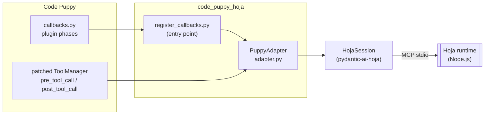

# Architecture

`code-puppy-hoja` is a thin adapter. The task gate, TaskManage, Hoja mode and traces are the **Hoja runtime**, the
same bundled code every Hoja plugin runs. It reaches the runtime through
[`pydantic-ai-hoja`](https://github.com/hoja-work/hoja-pydantic-ai-plugin)'s host-agnostic layer,
`pydantic_ai_hoja.runtime.HojaSession`. This package maps Code Puppy's plugin callbacks onto that session.

## Callback mapping

| Code Puppy callback | Runtime hook | What the adapter does |
| --- | --- | --- |
| `load_prompt` | session start | adds the TaskManage workflow and Hoja-mode rules to every agent's prompt |
| `register_tools` + `register_agent_tools` | `tools/list` | registers each runtime tool (`Tool.from_schema`) and opts every agent in |
| `user_prompt_submit` | `UserPromptSubmit` | appends the runtime's context to the prompt |
| `pre_tool_call` | `PreToolUse` | returns `{"blocked": True, "reason"}` or `{"context_message"}` |
| `post_tool_call` | `PostToolUse` / `PostToolUseFailure` | records the result (Code Puppy passes `{"error": …}` on failure) |
| `transform_model_messages` | `PostToolBatch` | at the first request after a tool batch settles, adds queued reminders to that outbound request only |
| `agent_run_result` | `Stop` | returns `{"retry": True, "prompt": <continuation>}`; Code Puppy's follow-up run skips `user_prompt_submit`, so the runtime's budget is not reset |
| `custom_command` / `custom_command_help` | `UserPromptExpansion` | `/hoja …` answered locally |
| `register_settings` | — | the `Hoja` section of `/set` |
| `shutdown` | `SessionEnd` | journal and trace flushed |

## Pairing tool calls

`pre_tool_call` carries no tool-call id. Code Puppy hands `pre_tool_call` and `post_tool_call` the same `tool_args`
dict, so the adapter mints an id in `pre_tool_call` and keys it by that dict's identity until `post_tool_call`.

## Failing open

Code Puppy must keep working when Hoja cannot: without Node.js the first callback disables the adapter with one
warning, and every later callback returns "no change". An adapter error on one call is logged and that call proceeds.
The runtime's own decisions (a block, a rejected completion) are not errors and always apply.

## Known limits

- One Hoja session per Code Puppy process. `/session` switches inside Code Puppy share one task list.
- Model text reaches the transcript at the end of a run (`agent_run_result`), not per response, so traces show tool
  spans and turns, but not per-request token usage.
- In headless `code-puppy -p "/hoja …"` mode Code Puppy exits before rendering a command's text. Use interactive mode,
  or `HOJA_DEBUG_LOG`, to see it.
